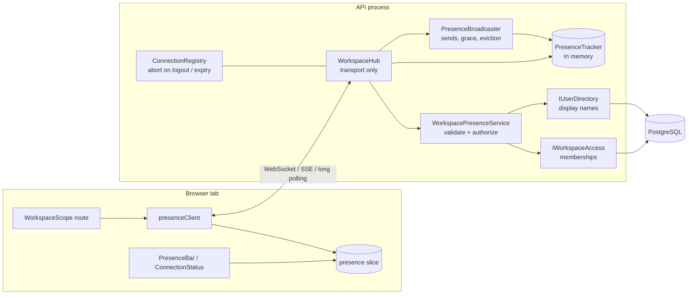
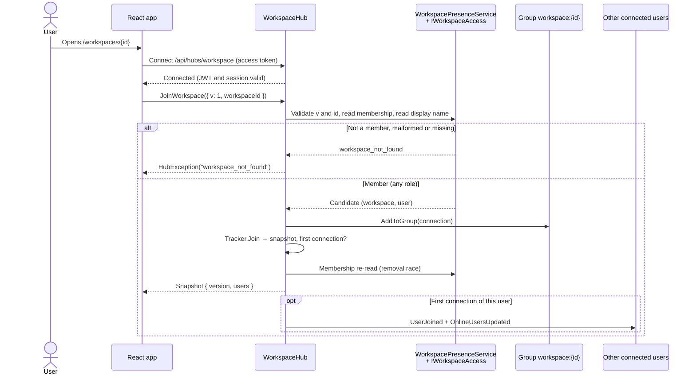
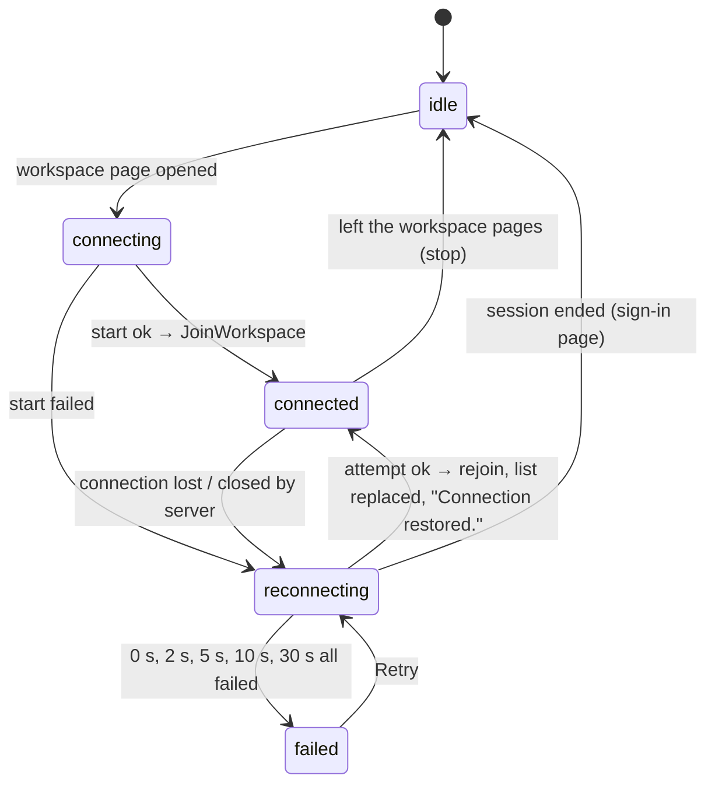

# Real-Time Workspace Presence

**Spec**: [005 Real-Time Workspace Presence](../../specs/005-workspace-presence/spec.md) ·
**Contract**: [workspace-hub.md](../../specs/005-workspace-presence/contracts/workspace-hub.md) ·
**Decision**: [ADR 0005](../adr/0005-realtime-presence.md)

DevSync's first real-time feature lets members of a workspace see who else is in it right now.
It doesn't synchronize content. Files and diagrams still save one change at a time, with conflict
detection.

## Architecture



| Piece | Layer | Responsibility |
|-------|-------|----------------|
| `WorkspaceHub` (`/api/hubs/workspace`) | Api | Reads identity from claims, calls the service, tracker and broadcaster; errors become a code |
| `WorkspacePresenceService` | Application | Join validation: schema `v`, GUID id, fresh membership check, name from the directory |
| `PresenceTracker` (`IPresenceTracker`) | Application | Thread-safe workspace → user → connections map, transitions and versions |
| `PresenceBroadcaster` | Api | The only sender of events; runs the offline grace period, evicts removed members, closes ended sessions |
| `ConnectionRegistry` | Api | Live connection contexts, closed at access-token expiry or on logout |
| `presenceClient` | Frontend | One connection per tab, joins, stale-result guard, reconnect loop, token refresh, event validation |
| `presence` slice | Frontend | Status, current workspace, versioned list, baseline for notifications |
| `WorkspaceScope`, `PresenceBar`, `ConnectionStatus` | Frontend | Route-level join/leave, avatars and summary, connection messages |

**Hub endpoint**: `/api/hubs/workspace`. It sits under `/api`, so the existing nginx and Vite
proxies carry it, and both now forward the WebSocket upgrade.

**Group naming**: `workspace:{workspaceId}`, with the GUID lowercase and hyphenated. Clients never
name groups. The server adds a connection to a group only after authorizing the join.

## Events

| Direction | Name | Payload (all carry `v: 1`) |
|-----------|------|------------------------------|
| client → server | `JoinWorkspace` | `{ v, workspaceId }` → `{ v, workspaceId, version, users[] }` |
| client → server | `LeaveWorkspace` | none |
| server → group | `OnlineUsersUpdated` | `{ v, workspaceId, version, users[] }`, the authoritative list |
| server → group except the joiner | `UserJoined` | `{ v, workspaceId, version, user }` |
| server → group | `UserLeft` | `{ v, workspaceId, version, user, reason: "left" \| "removed" }` |
| server → removed member | `AccessRevoked` | `{ v, workspaceId }` |

A user is `{ userId, displayName, avatarUrl: null, status: "online" }`. It never includes an
email, role, session id, connection id or token.

Join errors are `HubException`s whose message is a code: `invalid_request`,
`workspace_not_found` (malformed id, missing workspace or non-member, deliberately the same) or
`unavailable`. The server never sends exception details.

## Authentication flow

1. The tab holds the 002 access token in memory. `accessTokenFactory` returns it, or first
   refreshes it through the shared single-flight `refreshSession` when it has less than 30
   seconds left.
2. SignalR sends the token as `Authorization: Bearer` for negotiate, and as `access_token` in the
   query string for WebSockets and SSE, because browsers can't set headers on those.
3. `JwtBearerEvents.OnMessageReceived` accepts the query-string token **only** under
   `/api/hubs`. Everywhere else it is ignored, and a test proves it.
4. The existing `OnTokenValidated` check rejects tokens of ended sessions, so the connection is
   refused with the usual 401 Problem Details.
5. The connection is closed:
   - when its token expires (`ConnectionRegistry` on the app's clock, with
     `CloseOnAuthenticationExpiration` as a backstop);
   - at once on logout (that session) or logout-all (every session of the user).

Request logs record route patterns, not URLs, so the query-string token never reaches a log. A
test scans the captured logs for it.

## Workspace authorization flow



Every join is checked at the moment it is made, against the same membership data as the HTTP API
(`IWorkspaceAccess`). A connection is added to the group before the snapshot is taken, so no
change in between is missed. If a removal commits between the check and the group add, the
re-read catches it and undoes the join.

Group membership is not an authorization mechanism. When an Owner removes a member
(`DELETE /api/workspaces/{id}/members/{userId}`), the endpoint calls
`PresenceBroadcaster.RevokeMembershipAsync`:
1. every connection of that user is evicted from the group;
2. they receive `AccessRevoked`;
3. the others receive `UserLeft` with reason `removed`, at once.

A role change (Editor ↔ Viewer) does nothing, because presence shows no roles.

## Connection lifecycle



- **One connection per tab.** `WorkspaceScope` is a layout route around a workspace's overview,
  Files, Diagrams and canvas pages:
  - moving between those pages keeps one join;
  - switching workspaces sends a new `JoinWorkspace` on the same connection (the server leaves
    the old group first);
  - leaving the workspace pages stops the connection.
- **Stale results**: each join has a generation number. A join result for a workspace the tab no
  longer shows is discarded.
- **Handlers** are registered once, when the connection object is created, and survive restarts
  of that object.

## Reconnection strategy

The client runs its own loop from `onclose` instead of SignalR's `withAutomaticReconnect`. This is
because the server also closes connections deliberately (at token expiry), and one loop handles
every case the same way:

1. The status becomes **"Reconnecting to DevSync…"** and the list is dimmed as possibly out of
   date.
2. Attempts are made after 0, 2, 5, 10 and 30 seconds. Each refreshes the token first if it is
   expiring.
3. On success, the client sends `JoinWorkspace` again (the old connection id is never reused),
   resets its version baseline (a restarted server counts from 1 again), replaces the list, and
   shows **"Connection restored."** for 4 seconds.
4. When all attempts fail, it shows **"Live presence unavailable"** with **Retry**. Files and
   diagrams keep working.
5. If the session has ended, the loop stops and the app shows sign-in, as for any expired
   session.

## Multiple connections and the grace period

A user is online in a workspace while at least one of their connections has joined it. They are
listed once, however many tabs or devices they use.

- **First connection**: `UserJoined` is sent to everyone else.
- **Another connection**: nothing is announced.
- **A connection that is not the last one ends**: nothing is announced.
- **The last connection ends** (closed, lost, or detected after the 30-second keep-alive
  timeout): the user stays listed for a **grace period of 5 seconds**
  (`DevSync__Presence__GracePeriodSeconds`). A rejoin within it cancels the pending departure,
  so a page reload produces no "left" or "joined" noise. Otherwise `UserLeft` is sent once.

**Ordering.** Every change gets a version from one counter that only increases.
- Clients apply an `OnlineUsersUpdated` only if it is for their workspace and newer than the list
  they show.
- They show a notification only for versions after their own join result, never about
  themselves, and once per version.

Duplicate or out-of-order deliveries are therefore harmless.

**Thread safety.** The tracker updates all state under one lock and copies snapshots inside it.
Duplicate disconnects and leaves are no-ops, and two connections of one user ending at the same
moment produce exactly one pending departure. Both are covered by tests, including a 200-operation
parallel stress test.

## Limits of in-memory tracking

- **Single instance only.** Presence lives in one API process (like the existing rate limiter).
  Two API instances would each see half the connections, and group sends would reach only local
  connections.
- **Restarts forget everything.** After a restart, presence is rebuilt from clients as they
  reconnect and rejoin. Nobody stays "online" through a lost connection.
- **No history.** Online state is never written to PostgreSQL, so there is no "last seen".
- **Revocation by other routes.** Logout, logout-all and member removal take effect at once.
  Other session revocations (such as refresh-token reuse detection) take effect at the next
  access-token expiry, at most 15 minutes, when the connection is closed and can't reconnect.

## Path to distributed presence

The hub, service, contracts and frontend stay as they are. Only the pieces behind the seams
change:

1. **Cross-instance delivery**: add a SignalR backplane (the Redis backplane, or Azure SignalR
   Service), so group sends reach every instance.
2. **Shared tracking**: implement `IPresenceTracker` on a shared store with the same transition
   semantics. Use atomic scripts for "first or last connection", keep per-instance connection
   leases with TTL heartbeats so a crashed instance's connections expire, and keep the global
   version as an atomic counter.
3. **Grace period**: replace in-process timers with expiring keys and a single-consumer sweeper
   that announces departures.
4. **Session aborts**: publish "session ended" on the backplane so the instance holding the
   connection closes it.

Redis or a backplane needs an approved spec (constitution IX). This is planned in roadmap S12.

## Testing it locally

```powershell
docker compose up --build -d          # http://localhost:8080
```

1. In a normal window and a private window, register two accounts. Create a workspace in one
   and invite the other (accept in the second window).
2. Open the workspace in both: each header shows two avatars and "2 online".
3. Close the second window: about 5 seconds later the first shows "<Name> left the workspace."
4. Reload a window: nobody gets a notification.
5. DevTools → Network → **Offline**, then **Online**: "Reconnecting to DevSync…", then
   "Connection restored."
6. Remove the member as Owner: they see "You no longer have access to this workspace."

Automated checks:
- `dotnet test tests/backend/DevSync.UnitTests --filter FullyQualifiedName~Presence`
- `dotnet test tests/backend/DevSync.IntegrationTests --filter FullyQualifiedName~Presence`,
  which drives real hub connections against PostgreSQL in Testcontainers
- `npm test --prefix src/frontend -- presence`, which runs the components and client against an
  in-memory fake hub

For native development, `npm run dev` proxies `/api` with `ws: true`, so the hub works through
Vite.
