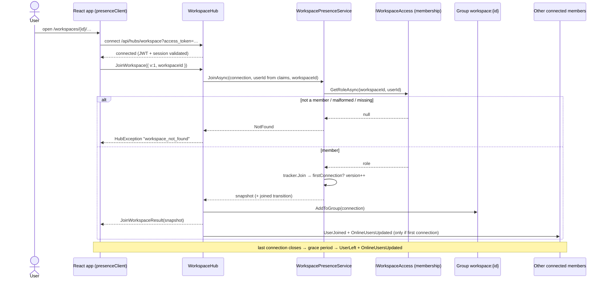

# Implementation Plan: Real-Time Workspace Presence

**Branch**: `005-workspace-presence` (created from the committed 004 branch) | **Date**: 2026-11-01 |
**Spec**: [spec.md](./spec.md)

**Input**: Feature specification from `specs/005-workspace-presence/spec.md`. No clarification
questions were needed; the defaults are recorded in the spec's Assumptions.

## Summary

DevSync's first real-time feature: workspace members see who else is online.

- **Transport** (research R1): ASP.NET Core SignalR, which ships in the shared framework, so the
  API needs no new package. One strongly typed hub, `WorkspaceHub : Hub<IWorkspaceClient>`, at
  `/api/hubs/workspace`, behind the existing nginx and Vite `/api` proxies (WebSocket upgrade
  added). Browser client: `@microsoft/signalr` 10.0.11.
- **Sign-in** (R2): the existing JWT bearer scheme. Browsers can't set headers on WebSockets, so
  for the hub path only, the token is also accepted from the `access_token` query string. The
  existing per-request session check runs at connect. `CloseOnAuthenticationExpiration` closes
  the connection when the 15-minute token expires (R3). Logout and logout-all abort the
  connections of the ended sessions immediately.
- **Authorization** (R4): every `JoinWorkspace` reads the caller's role fresh through the existing
  `IWorkspaceAccess` (the same source the HTTP `RequireWorkspace` filter uses). No role = "not
  found". Group membership is never treated as authorization: removal of a member actively
  evicts their connections from the group.
- **Tracking** (R5, R6): an in-memory `PresenceTracker` (one lock, plain dictionaries) maps
  workspace → user → connections and connection → (user, session, workspace). It returns
  *transitions* (first connection = joined; last connection gone = pending offline), and a
  per-workspace **version** that orders snapshots. A 5-second **grace period** before "left"
  absorbs reloads and blips.
- **Separation** (R7):
  - the hub is thin transport: it reads the identity and delegates;
  - `WorkspacePresenceService` (Application) holds the rules (validate the id, authorize, look
    up the display name, update the tracker) and returns what to announce;
  - `PresenceBroadcaster` (Api) sends the events and schedules the grace-period check.
- **Events** (R8, [contracts/workspace-hub.md](./contracts/workspace-hub.md)):
  - client → server: `JoinWorkspace`, `LeaveWorkspace`;
  - server → client: `OnlineUsersUpdated` (an authoritative, versioned snapshot), `UserJoined`
    and `UserLeft` (versioned, used for notifications only), and `AccessRevoked`.
- **Frontend** (R9–R11):
  - a single `presenceClient` per tab owns the connection, the subscriptions (registered once)
    and its own reconnect loop (0, 2, 5, 10, 30 s), refreshing the token through
    `refreshSession` when needed;
  - a `presence` Redux slice holds the status and the latest snapshot;
  - a `WorkspaceScope` layout route keeps one join alive across the pages of a workspace and
    leaves it (or stops the connection) on navigation;
  - `PresenceBar` in `WorkspaceNav` and the canvas header shows avatars, the count, and a summary
    popover; `ConnectionStatus` and toasts carry the messages.

## Technical Context

**Language/Version**: C# 14 / .NET 10 (SDK 10.0.402); TypeScript 6.0 on Node 24. Unchanged.

**Primary Dependencies (new)**:
- frontend: `@microsoft/signalr` 10.0.11 (MIT, Microsoft; the official client for the server
  framework already in use).
- backend tests: `Microsoft.AspNetCore.SignalR.Client` 10.0.14, to drive the hub in integration
  tests.
- The API itself needs no new package: SignalR is part of `Microsoft.AspNetCore.App`.

**Storage**: none new. No migration. Presence is in memory (FR-018/019); membership and sessions
are read through the existing repositories.

**Testing**:
- **Backend unit** (xUnit v3): `PresenceTracker` (multi-connection, last connection, duplicates,
  ordering and versioning, concurrency stress with `Parallel.ForEachAsync`) and
  `WorkspacePresenceService` (validation, authorization, idempotency, grace confirmation) with
  fakes and `FakeTimeProvider`.
- **Backend integration** (Testcontainers + `WebApplicationFactory`): real hub connections over
  the test server (long polling through the in-memory handler) covering:
  - authenticated and unauthenticated connect;
  - member join and non-member refusal;
  - `UserJoined`, `UserLeft` after the grace period, and multi-connection;
  - group isolation;
  - removal eviction, logout abort, and token expiry closing.
- **Frontend** (Vitest + RTL): a fake hub connection injected through the client's transport
  seam, covering:
  - connect and join;
  - list rendering;
  - joined and left notifications;
  - reconnecting and restored states;
  - failure and retry;
  - navigation cleanup;
  - handler de-duplication;
  - access revoked.

**Target Platform**: local Docker Compose and native development. Single API instance.

**Project Type**: web application ([ADR 0001](../../docs/adr/0001-repository-layout.md)).

**Performance Goals**: none claimed (Principle XII). By design:
- a join is one role lookup plus one user lookup;
- an event is one group send;
- snapshots are bounded by the workspace's membership.

**Constraints**:
- no Redis, broker or backplane, and no presence persistence;
- tokens are never logged (the request logger logs route patterns only; the hub's query-string
  token never reaches a log template);
- S01–S04 contracts are unchanged.

**Scale/Scope**: one API process; the number of online members per workspace is bounded by its
membership.

## Constitution Check

*GATE: passed before Phase 0 and re-checked after Phase 1.*

| Principle | How this plan complies |
|-----------|------------------------|
| I. Incremental | Presence only. No collaborative editing, cursors, chat or anything that pre-wires them. The hub exposes exactly two client methods. |
| II. Clean architecture | Hub = transport, `WorkspacePresenceService` and `PresenceTracker` = application logic, broadcaster = API adapter. The domain is untouched. The frontend splits into a service (`presenceClient`), state (`presenceSlice`) and UI. |
| III. Correctness | Acceptance criteria are in the spec. Concurrency, reconnection, duplicate events and races are unit- and integration-tested (R5, R12). Join errors are explicit `HubException` codes. |
| IV. Security | Authenticated connect, and membership checked on **every** join through the same `IWorkspaceAccess`. Identity comes only from claims. Removal evicts. Session end aborts connections. Token expiry closes connections. The payload has no email, role or ids beyond the user id (R4, R2, R3). |
| V. Testability | Unit tests for the tracker and service, integration tests for the hub, component tests for the UI and client. |
| VI. Real-time correctness | Defined in [contracts/workspace-hub.md](./contracts/workspace-hub.md) and R8: message schemas with `v: 1`, validated on receipt in both directions. Room boundary = `workspace:{id}`, with authorization per join. Ordering by per-workspace version; reconnection = rejoin + snapshot replace. Conflicts: none possible (the server is the sole writer of presence; the snapshot wins). |
| VII. Persistence | Presence is explicitly non-durable and documented so (FR-018/019). No schema change. |
| VIII. Observability | Structured events `presence.*` with the user and workspace ids. The connection id stays in logs only, never in payloads. No tokens. |
| IX. Simplicity | In-process, no new infrastructure. The distributed path is documented, not built (R6). |
| X. Developer experience | README and quickstart describe running and observing presence in two browsers. No new environment variables are required (optional `DevSync:Presence:GracePeriodSeconds`). |
| XI. Dependencies | Official SignalR server (built in) and client. Alternatives are recorded in R1. |
| XII. Evidence | No performance figures claimed. |

**SHOULD-level exception (Principle II, abstractions)**: `IPresenceTracker` has one production
implementation. It is kept as the seam for the documented distributed-presence path (FR-035,
NFR-005) and lets the service be unit-tested without timing races. Recorded here as required.

## Architecture



The `docs/architecture/realtime-presence.md` file will hold this diagram plus the lifecycle,
revocation and distributed-path diagrams (FR-035).

### Backend components

| Component | Layer | Responsibility |
|-----------|-------|----------------|
| `Presence/PresenceContracts.cs` | Application | DTOs: `PresenceUserDto`, `OnlineUsersDto`, `UserJoinedDto`, `UserLeftDto`, `AccessRevokedDto`, `JoinWorkspaceRequest`, `JoinWorkspaceResult` |
| `Presence/IPresenceTracker.cs`, `PresenceTracker.cs` | Application | Thread-safe in-memory tracking, transitions and versions (data-model.md) |
| `Presence/WorkspacePresenceService.cs` | Application | Join/leave/disconnect/confirm-offline/revoke rules; uses `IWorkspaceAccess`, `IUserDirectory`, `IPresenceTracker`, `TimeProvider`; returns `PresenceChange` results |
| `Presence/PresenceOptions.cs` | Application | `GracePeriod` (default 5 s), bound from `DevSync:Presence` |
| `Realtime/WorkspaceHub.cs` | Api | `[Authorize]` strongly typed hub; `JoinWorkspace`, `LeaveWorkspace`, `OnConnectedAsync`, `OnDisconnectedAsync` |
| `Realtime/IWorkspaceClient.cs` | Api | Server → client method signatures |
| `Realtime/PresenceBroadcaster.cs` | Api | Sends changes to groups/connections via `IHubContext<WorkspaceHub, IWorkspaceClient>`; schedules grace checks; evicts on removal; aborts on session end |
| `Realtime/ConnectionRegistry.cs` | Api | connection id → `HubCallerContext` (for `Abort`) + session id; singleton |
| `Realtime/RealtimeSetup.cs` | Api | `AddDevSyncRealtime()` (SignalR options, JSON camelCase, keep-alive, `MaximumReceiveMessageSize` 4 KB) and `MapDevSyncHubs()` with `CloseOnAuthenticationExpiration` |
| `Auth/AuthSetup.cs` (edit) | Api | `OnMessageReceived`: take `access_token` from the query **only** for `/api/hubs/` paths |
| `Endpoints/WorkspaceEndpoints.cs` (edit) | Api | After a successful member removal → `broadcaster.RevokeMembershipAsync` |
| `Endpoints/AuthEndpoints.cs` (edit) | Api | After logout → abort that session's connections; after logout-all → abort the user's connections |

### Frontend components

| Component | Responsibility |
|-----------|----------------|
| `features/presence/presenceClient.ts` | The single connection per store/tab: build `HubConnection`, `accessTokenFactory` (refresh when ≤ 30 s left), handlers registered once, `join(id)` / `leave()` with a request generation counter (stale results dropped), its own reconnect loop, `stop()`; transport seam for tests |
| `features/presence/presenceSlice.ts` | `status` (`idle`/`connecting`/`connected`/`reconnecting`/`failed`), `workspaceId`, `version`, `users`, `revoked`; reducers accept snapshots only if same workspace and newer version |
| `features/presence/presenceEvents.ts` | Validates incoming payloads (`v === 1`, shapes) before dispatch |
| `features/presence/WorkspaceScope.tsx` | Layout route for `workspaces/:workspaceId/*`: joins on mount/param change, leaves/stops on unmount |
| `features/presence/PresenceBar.tsx` | Avatars with online dots, "+N", "N online", summary popover (keyboard + `aria-expanded`), stale styling |
| `features/presence/ConnectionStatus.tsx` | "Reconnecting to DevSync…", "Connection restored.", "Live presence unavailable" + Retry; `role="status"` |
| `features/presence/presenceToasts` (listener) | `UserJoined`/`UserLeft` → existing toast; never about self; once per version |
| `app/router.tsx`, `app/store.ts`, `WorkspaceNav.tsx`, `DiagramPage.tsx` (edits) | Route nesting, reducer and listeners, bar placement |
| `vite.config.ts`, `nginx.conf` (edits) | WebSocket upgrade for `/api/hubs/` |

## Project Structure

### Documentation (this feature)

```text
specs/005-workspace-presence/
├── plan.md
├── research.md
├── data-model.md
├── quickstart.md
├── contracts/
│   ├── workspace-hub.md      # hub endpoint, methods, events, payloads, errors
│   └── ui-presence.md        # header, popover, status and notification behaviour
├── checklists/requirements.md
└── tasks.md                  # /speckit-tasks
```

### Source Code (repository root)

```text
src/backend/
├── DevSync.Application/Presence/            # new: contracts, tracker, service, options
├── DevSync.Api/Realtime/                    # new: hub, client interface, broadcaster, registry, setup
├── DevSync.Api/Auth/AuthSetup.cs            # edit: hub query-string token
├── DevSync.Api/Endpoints/{Workspace,Auth}Endpoints.cs  # edit: revoke / abort hooks
└── DevSync.Api/Program.cs                   # edit: AddDevSyncRealtime / MapDevSyncHubs
src/frontend/
├── src/features/presence/                   # new
├── src/app/{router,store}.tsx|ts            # edit
├── src/features/workspaces/WorkspaceNav.tsx # edit: PresenceBar
├── src/features/diagrams/DiagramPage.tsx    # edit: PresenceBar in canvas header
├── nginx.conf, vite.config.ts               # edit: WebSocket upgrade
tests/backend/DevSync.UnitTests/Application/Presence/
tests/backend/DevSync.IntegrationTests/Presence/
tests/frontend/features/presence/ (+ support/fakeHub.ts)
docs/architecture/realtime-presence.md, docs/adr/0005-realtime-presence.md, README.md
```

**Structure Decision**: same web layout as 001–004. Presence is a new Application module plus an
Api `Realtime` adapter; the frontend gets a `features/presence` slice. No new projects.

## Complexity Tracking

| Violation | Why Needed | Simpler Alternative Rejected Because |
|-----------|------------|-------------------------------------|
| `IPresenceTracker` with one implementation (SHOULD, Principle II) | Seam for the documented distributed presence store; keeps the service unit-testable | Concrete class only: the future store would force edits through the service and hub |
